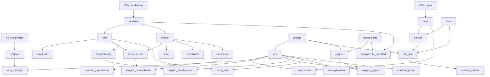

# Seed · Carga masiva determinística

Generador de datos para el TPI «Bodegas del Atuel». Produce un dataset
reproducible a partir de semillas fijas (`random.seed(42)`, `Faker.seed(42)`)
y los catálogos CSV de `db/seed/catalogos/`.

## Uso

```bash
# Desde la raíz del repositorio, con PostgreSQL disponible:
scripts/seed.sh --scale small --fecha-base 2026-01-01

# O directamente:
python3 db/seed/seed.py --scale small --fecha-base 2026-01-01

# Verificar reproducibilidad en dos PostgreSQL efímeros (Docker requerido):
scripts/verify_reproducibility.sh --scale small --fecha-base 2026-01-01
```

El verificador repite el seed, compara cantidad de filas y hashes canónicos en
todas las tablas base públicas (29 en el esquema actual), y exige que los
controles de integridad 2–6 devuelvan cero.
Usa contenedores temporales independientes del entorno de desarrollo.

| Opción | Valores | Descripción |
|---|---|---|
| `--scale` | `small` \| `full` | `small`: datos mínimos para desarrollo. `full`: volumen para benchmarks. |
| `--fecha-base` | `YYYY-MM-DD` | Fecha de referencia para los datos históricos (por defecto, hoy). |
| `--db-url` | URL psycopg3 | Conexión a PostgreSQL (por defecto, `postgresql://bodegas@localhost:5433/bodegas_del_atuel`). |
| `--benchmark` | flag | Mide INSERT fila por fila vs COPY por lotes (5.000 filas). |

## Orden de carga

El orden respeta las claves foráneas. Los catálogos CSV primero, luego las
entidades independientes y finalmente las dependientes.



### Orden concreto de inserción

1. `localidad` — desde `localidades_mendoza.csv` (sin IDs)
2. `cepa` — desde `cepas.csv` (sin IDs)
3. `maridaje` — desde `maridajes.csv` (sin IDs)
4. `bodega` — Faker (`cuit_dom`)
5. `transportista` — Faker
6. `finca` — Faker
7. `sala` — Faker → `localidad`
8. `empleado` — Faker → `sala`
9. `parcela` — Faker → `finca`, `cepa`
10. `vino` — Faker → `bodega` (INSERT con `RETURNING` por `GENERATED ALWAYS`)
11. `cliente` — Faker → `localidad`
12. `lote_uva` — Faker → `parcela`, `bodega`
13. `composicion` — vino × cepa, suma exacta 100.00
14. `vino_maridaje` — vino × maridaje
15. `socio`, `distribuidor`, `exportador` — subtipos de `cliente`
16. `permiso_exportacion` — → `exportador`
17. `transportista_localidad` — N:M
18. `analisis_calidad` — → `lote_uva`
19. `comprobante` — histórico, triggers desactivados
20. `renglon_comprobante` — histórico, triggers desactivados
21. `ingreso` — → `transportista`, `bodega`
22. `renglon_ingreso` — → `ingreso`, `vino`
23. `transferencia` — → `sala`
24. `renglon_transferencia` — → `transferencia`, `vino`
25. `stock_deposito` — → `vino`
26. `stock_sala` — → `sala`, `vino`
27. Recalcular totales de `comprobante` y reactivar triggers

## Estrategia frente a triggers

Los triggers de `005_triggers.sql` (RN-08, RN-09) calculan precios y
descuentan stock al insertar renglones de comprobante. Para la carga
histórica se desactivan con `ALTER TABLE ... DISABLE TRIGGER USER`, se
insertan los datos con COPY y al finalizar se recalculan los totales de
`comprobante` y se reactivan con `ENABLE TRIGGER USER`.

## Determinismo

- `random.seed(42)` y `Faker.seed(42)` al inicio.
- Los IDs subrogados se asignan explícitamente en orden secuencial
  (las tablas usan `GENERATED BY DEFAULT`, excepto `vino` que es
  `GENERATED ALWAYS`).
- No se asumen IDs `1..n`: se construyen diccionarios `nombre → id` para
  resolver FKs.
- La recarga con `TRUNCATE ... RESTART IDENTITY CASCADE` produce el mismo
  dataset.

## Requisitos

- Python 3.10+
- Versiones exactas de `psycopg[binary]` y `faker` fijadas en
  `db/seed/requirements.txt` para alinear entornos.

```bash
python3 -m pip install -r db/seed/requirements.txt
```
