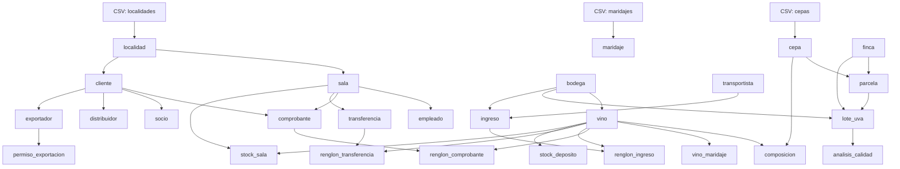

# Carga masiva determinística (Fase 3 · Tareas 3.1–3.7)

## 3.1 · Orden de carga

El orden sigue la topología de claves foráneas. Los catálogos CSV se cargan
primero porque no tienen dependencias; luego las entidades independientes y
finalmente las dependientes. El diagrama completo está en
[`db/seed/README.md`](../db/seed/README.md).



## 3.2 · Determinismo y CLI

- `random.seed(42)` y `Faker.seed(42)` al inicio de cada corrida.
- `--scale small` produce datos mínimos (50 comprobantes, 151 renglones) en el esquema de 29 tablas.
- `--scale full` produce 20.000 comprobantes y ~350.000 renglones.
- `--fecha-base YYYY-MM-DD` define la fecha de referencia para datos históricos.
- Todas las fechas se calculan relativas a `fecha_base`, nunca como valores absolutos.

## 3.3 · Sembrado dirigido para la Sección 8

| Consulta | Qué se siembra |
|---|---|
| D1 | Comprobantes de socios con `fecha_alta > 5 años` |
| D4/D6 | Socios sin compra, alta > 5 años, localidad específica |
| U2/D3 | Empleados con > 5 años y < 5 años de antigüedad |
| U4 | Salas con `dia_cierre_semanal = 1` (Lunes) y `= 3` (Miércoles) |
| U6 | Exportadores con 4+ permisos de exportación |
| I1 | Localidad 'General Alvear' en el CSV; transportista con menos ingresos |
| I2 | Vinos tintos con `graduacion ≥ 14` |
| I6 | Vino 'Malbec Reserva' de presentación 750 ml |
| D5 | Ingresos en estado `'procesado'` con `fecha > 365 días` |
| RN-05 | Todas las composiciones suman exactamente `100.00` |

## 3.4 · Estrategia frente a triggers

Los triggers de `005_triggers.sql` (RN-08, RN-09, RN-10, RN-11, RN-12)
validan y calculan al insertar. Para la carga histórica se desactivan:

```sql
ALTER TABLE renglon_comprobante   DISABLE TRIGGER USER;
ALTER TABLE comprobante            DISABLE TRIGGER USER;
ALTER TABLE ingreso               DISABLE TRIGGER USER;
ALTER TABLE transferencia          DISABLE TRIGGER USER;
ALTER TABLE renglon_ingreso        DISABLE TRIGGER USER;
ALTER TABLE renglon_transferencia  DISABLE TRIGGER USER;
```

**Ventajas:** carga rápida sin validación por fila; se insertan datos
históricos con estados `procesado`/`terminado` que los triggers rechazarían.

**Riesgos:** los triggers no validan durante la carga. Se compensa con
`db/seed/controles.sql`, que verifica integridad referencial, stocks no
negativos, composiciones = 100 % y totales de comprobante consistentes.

Al finalizar se recalculan los totales con un solo `UPDATE` por conjuntos y se
reactivan los triggers con `ENABLE TRIGGER USER`.

## 3.5 · Protocolo COPY y Benchmark

Se usa `psycopg3.copy()`:

```python
with cur.copy("COPY tabla (col1, col2) FROM STDIN") as copy:
    for row in rows:
        copy.write_row(row)
```

Para `vino` se usa `INSERT ... RETURNING` porque `cod_vino` es
`GENERATED ALWAYS AS IDENTITY` y COPY no permite override.

### Resultado del benchmark (5.000 filas)

| Método | Tiempo | Speedup |
|---|---|---|
| INSERT fila por fila | 3,972 s | 1x |
| COPY por lotes | 0,032 s | **125,9x** |

Reproducir con:

```bash
python3 db/seed/seed.py --benchmark
```

## 3.6 · Consultas de control

`db/seed/controles.sql` verifica:

1. Conteo por tabla (29 tablas).
2. 0 filas huérfanas (FK no resueltas).
3. 0 stocks negativos.
4. 0 comprobantes con `total ≠ SUM(subtotal)` de sus renglones.
5. 0 vinos con composición ≠ 100.
6. 0 estados inválidos en `ingreso` y `transferencia`.

## 3.7 · Script y dump

```bash
scripts/seed.sh --scale small --fecha-base 2026-01-01
```

El script ejecuta `seed.py` y luego `controles.sql`. El dump del dataset
completo se genera con `pg_dump` después de la carga:

```bash
pg_dump --data-only --no-owner bodegas_del_atuel > seed_dump.sql
```

## 3.8 · Prueba de reproducibilidad

El script crea dos PostgreSQL efímeros independientes, aplica las migraciones
001–007, carga el seed, aplica 008 y ejecuta los controles. Compara para cada
una de las tablas públicas base la cantidad de filas y el MD5 de sus filas
serializadas y ordenadas canónicamente; además exige cero errores en los
controles 2–6. La migración 001 declara 29 tablas; el primer bloque informa el
conteo de todas ellas, incluida `auditoria_precio` (vacía en este seed), que
también se hashea.

```bash
scripts/verify_reproducibility.sh --scale small --fecha-base 2026-01-01
scripts/verify_reproducibility.sh --scale small --fecha-base 2026-01-01 --fecha-base-b 2026-02-01
```

### Resultados observados

| Caso | Resultado observado |
|---|---|
| Fechas iguales, 2026-01-01 | Exit 0; 29/29 tablas PASS; 6 bloques sin errores. |
| A 2026-01-01 vs. B 2026-02-01 | Exit 1; 7 tablas FAIL: `analisis_calidad`, `cliente`, `comprobante`, `empleado`, `ingreso`, `permiso_exportacion`, `transferencia`. |

### Resultado positivo por tabla

| Tabla | Filas | Resultado | Tabla | Filas | Resultado |
|---|---:|---|---|---:|---|
| analisis_calidad | 10 | PASS | auditoria_precio | 0 | PASS |
| bodega | 5 | PASS | cepa | 12 | PASS |
| cliente | 15 | PASS | composicion | 67 | PASS |
| comprobante | 50 | PASS | distribuidor | 4 | PASS |
| empleado | 10 | PASS | exportador | 4 | PASS |
| finca | 3 | PASS | ingreso | 20 | PASS |
| localidad | 18 | PASS | lote_uva | 10 | PASS |
| maridaje | 8 | PASS | parcela | 7 | PASS |
| permiso_exportacion | 14 | PASS | renglon_comprobante | 151 | PASS |
| renglon_ingreso | 53 | PASS | renglon_transferencia | 39 | PASS |
| sala | 4 | PASS | socio | 7 | PASS |
| stock_deposito | 26 | PASS | stock_sala | 40 | PASS |
| transferencia | 15 | PASS | transportista | 5 | PASS |
| transportista_localidad | 15 | PASS | vino | 26 | PASS |
| vino_maridaje | 49 | PASS |  |  |  |

Los seis bloques del control positivo devolvieron, en orden: bloque 1
(conteos): 29 filas, incluida `auditoria_precio` con 0; bloque 2 (huérfanas): 0 en sus 7
controles; bloque 3 (stock negativo): 0 en sus 2 controles; bloque 4 (totales
de comprobante): 0; bloque 5 (composición): 0; bloque 6 (estados inválidos):
0 en sus 2 controles.

El resultado positivo debe mostrar PASS para las 29 tablas y los seis bloques
de controles sin errores. Las versiones de Faker y psycopg están pinneadas en
`db/seed/requirements.txt`; usar ese archivo permite alinear las dependencias
entre entornos.
